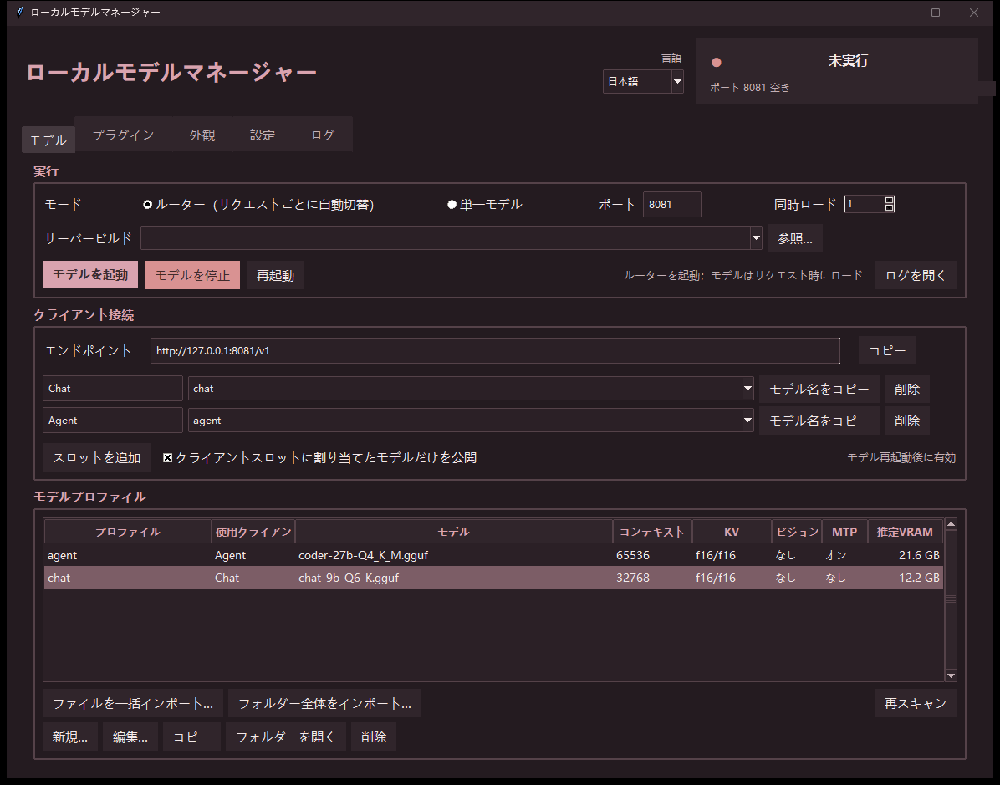

# ローカルモデルマネージャー

**Local Model Manager** · **本地模型管理器**

[llama.cpp](https://github.com/ggml-org/llama.cpp) 用の、Python 標準ライブラリだけで動くデスクトップマネージャーです。

[English](README.md) · [简体中文](README.zh.md) · **日本語**

複数の GGUF モデルをプロファイルとして登録し、リクエストに応じて自動で切り替えます。
1 つの llama.cpp **ルーター**エンドポイントで、チャットクライアントとコーディング
エージェントを同時に扱えます。読み込むのは、リクエストで指定されたモデルだけです。



---

## 機能

- **一括インポート**：複数の GGUF をまとめて、またはフォルダーごと取り込みます。
- **モデルプロファイル**：モデル、視覚プロジェクター、コンテキスト長、KV キャッシュ、
  GPU レイヤー数、バッチサイズ、追加引数、MTP、ロードモード。
- **クライアントスロット**：任意の数の名前付きエンドポイントをプロファイルに割り当てます。
- **ルーターモード**：`llama-server` を 1 つだけ起動し、全プロファイルをモデル別名として
  公開します。必要なモデルだけをオンデマンドで読み込みます。
- **シングルモード**：同時に 1 つのモデルだけを動かします。
- **VRAM 見積もり**：GGUF のメタデータから、モデル + KV + 視覚 + 計算バッファー +
  CUDA コンテキストを計算します。可能なら実際の GPU メモリも読み取ります。
- **プラグインカード**：SillyTavern、Genie TTS、GPT-SoVITS をワンクリックで起動。
- **中国語 / 英語 / 日本語 UI**。切り替えは即時反映されます。
- **サードパーティの Python パッケージは不要です。** マネージャーは標準
  ライブラリのみを使用します（任意の TTS ラッパーには独自の依存関係があります）。

---

## 動作環境

- Windows 10/11 のみ対応。Linux と macOS は**未対応**（未テスト）。
- Python 3.10 以上（Tkinter 付き）。
- `llama-server` を含む [llama.cpp](https://github.com/ggml-org/llama.cpp) のビルド。
- CUDA 版と Vulkan 版の llama.cpp ビルドに対応しています。
- 動作確認済み：RX 6750 GRE 12G、RTX 2080 Ti 22G、RTX 4060 Ti 8G。

---

## クイックスタート

1. llama.cpp のビルドは任意の場所に置きます。自動検出されない場合は、
   **设置** の **参照…** から `llama-server` を手動で選択してください。
   CUDA 版・Vulkan 版のどちらも使えます。
2. マネージャーを起動します。Windows なら `启动管理器.bat`、または `python model_manager.pyw`。
3. **模型** タブで **批量导入** をクリックし、`.gguf` ファイルを追加します。
4. **客户端** タブで、呼び出したいモデルのスロットを作成して選択します。
5. **启动** をクリックします。

`config.json` はスクリプトの隣に自動生成されます。パスはすべてこのフォルダーからの
相対パスなので、フォルダーごと移動できます。

---

## ルーターモード

ルーターモードでは、`llama-server` が 1 つのポートで待ち受けます。各プロファイルは
モデル別名になり、リクエストの `model` に応じて読み込まれます：

```json
{"model": "chat",  "messages": [...]}
{"model": "agent", "messages": [...]}
```

リクエストで指定されたモデルだけを 1 つずつ読み込みます。チャット UI と
コーディングエージェントが 1 つのエンドポイントを共有でき、サーバーを 2 つ
起動する必要はありません。

各フィールドの詳細は [docs/configuration.md](docs/configuration.md) を参照してください。

---

## プラグインとサービス

**插件** タブは、ローカルサービスをクリック可能なカードとして表示します。
マネージャー自身、または親フォルダーにある次のサービスを検出します：

| サービス | 検出パス | 既定ポート |
|---|---|---|
| Genie TTS | `Genie-TTS GUI/server.bat` または `tts/server.bat` | 9880 |
| TTS Proxy | `Genie-TTS GUI/start-proxy.bat` または `tts/start-proxy.bat` | 9881 |
| GPT-SoVITS API | `tts/start-gsv-api.bat` | 9883 |
| GSV Proxy | `tts/start-gsv-proxy.bat` | 9882 |

ポートは既定値です。変更する場合は、対応する `.bat` ファイルを編集してください。

SillyTavern も接続できますが、マネージャーはそのポートを管理しません。
SillyTavern 側で設定するか、カスタムサービスとして追加してください。

その他のプログラムは「カスタムサービス」として追加できます。
**本リポジトリはこれらのソフトを同梱しません。** マネージャーは、すでに
インストール済みのプログラムを起動するだけです。

### 内蔵 TTS ヘルパー

`tts/` フォルダーには、2 つのエンジン用のラッパーがあります：

- `server.py` — キャラクターモデルを 1 つ読み込み、Genie TTS を起動（9880）
- `proxy.py` — Genie 用の OpenAI 互換 `/v1/audio/speech` プロキシ（9881）
- `start-gsv-api.bat` — `tts/GPT-SoVITS/` から GPT-SoVITS を起動（9883）
- `gsv_proxy.py` — GPT-SoVITS `api_v2` 用の OpenAI 互換プロキシ（9882）

`server.py` / `proxy.py` は [genie-tts](https://github.com/High-Logic/Genie)
（MIT）のラッパーです。`start-gsv-api.bat` と `gsv_proxy.py` を使うには
GPT-SoVITS 本体を別途インストールしてください（同梱されていません）。

**音声モデルは同梱されていません。** 手順は
[TTS インストールガイド](tts/README.ja.md) を参照してください。

---

## セキュリティ

サーバーは既定で `127.0.0.1` にのみバインドされます。ネットワークに公開する場合は、
**设置** で API キーを設定してください。マネージャーは外部へ何も送信しません。

---

## クレジット

基本コードは **DeepSeek**（AI アシスタント）が作成しました。作者は調整と修正のみを行っています。

---

## ライセンス

MIT  llama.cpp も MIT ですが、本リポジトリには同梱していません。
