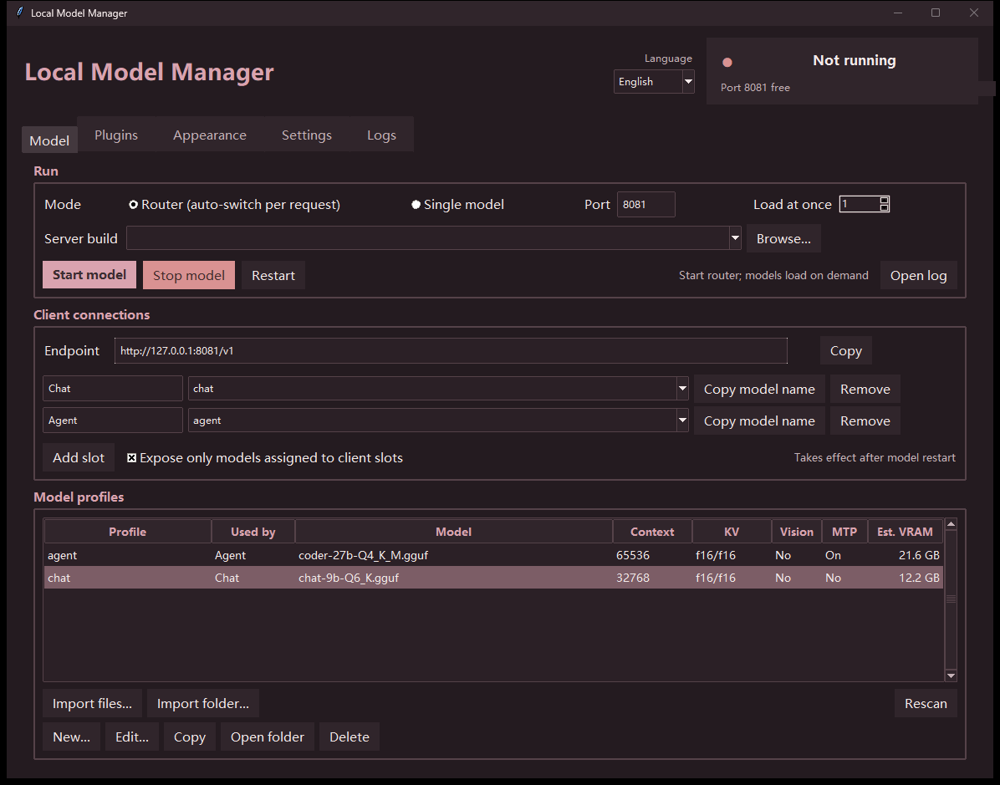

# Local Model Manager

**本地模型管理器** · **ローカルモデルマネージャー**

A small desktop manager for [llama.cpp](https://github.com/ggml-org/llama.cpp)
that uses only the Python standard library.

**English** · [简体中文](README.zh.md) · [日本語](README.ja.md)

It keeps several GGUF model profiles and switches between them automatically.
One llama.cpp **router** endpoint can serve a chat client and a coding agent at
the same time, loading only the model each request asks for.



---

## Features

- **Batch import** many GGUF files at once, or import a whole directory.
- **Named profiles**: model, vision projector, context size, KV cache type,
  GPU layers, batch sizes, extra CLI flags, MTP and load mode.
- **Client slots**: any number of named endpoints, each mapped to a profile.
- **Router mode**: one `llama-server` process exposes every profile as a model
  alias and loads it on demand.
- **Single mode**: run exactly one model at a time.
- **VRAM estimate** from GGUF metadata (model + KV + vision + compute buffers +
  CUDA context), with live GPU readings where available.
- **Plugin cards** for SillyTavern, Genie TTS and GPT-SoVITS.
- **Chinese / English / Japanese UI**, switchable live.
- **No third-party Python packages.** The manager uses only the standard
  library; the optional TTS wrappers have their own requirements.

---

## Requirements

- Windows 10/11. Linux and macOS are **not supported** (untested).
- Python 3.10+ with Tkinter.
- A [llama.cpp](https://github.com/ggml-org/llama.cpp) build containing
  `llama-server`.
- CUDA and Vulkan builds are both supported.
- Tested on RX 6750 GRE 12G, RTX 2080 Ti 22G, and RTX 4060 Ti 8G.

---

## Quick start

1. Put a llama.cpp build anywhere. If it is not detected, select
   `llama-server` manually with **浏览…** in **设置**. CUDA and Vulkan builds
   both work.
2. Start the manager: `启动管理器.bat` on Windows, or `python model_manager.pyw`.
3. Open **模型** and click **批量导入** to add your `.gguf` files.
4. Open **客户端**, create a slot for the model you want to call, and select it.
5. Click **启动**.

`config.json` is created next to the script. Everything is relative to that
folder, so the whole directory can be moved.

---

## Router mode

In router mode a single `llama-server` listens on one port. Each profile becomes
a model alias, and the model named in the request is loaded on demand:

```json
{"model": "chat",  "messages": [...]}
{"model": "agent", "messages": [...]}
```

Only the requested model is loaded, one at a time. This lets a chat UI and a
coding agent share one endpoint without running two servers.

See [docs/configuration.md](docs/configuration.md) for every field and option.

---

## Plugins and services

The **插件** tab turns local services into clickable cards. The manager detects
these if they sit next to it or in a parent folder:

| Service | Detected path | Default port |
|---|---|---|
| [Genie TTS](https://github.com/High-Logic/Genie) | `Genie-TTS GUI/server.bat` or `tts/server.bat` | 9880 |
| TTS Proxy | `Genie-TTS GUI/start-proxy.bat` or `tts/start-proxy.bat` | 9881 |
| [GPT-SoVITS API](https://github.com/RVC-Boss/GPT-SoVITS) | `tts/start-gsv-api.bat` | 9883 |
| GSV Proxy | `tts/start-gsv-proxy.bat` | 9882 |

Ports are only defaults; change them in the corresponding `.bat` file.

SillyTavern can also be connected, but the manager does not manage its port.
Configure that on SillyTavern's side, or add it as a custom service.

Any other program can be added as a custom service. Nothing is bundled: the
manager only launches what you already installed.

### Built-in TTS helpers

The `tts/` folder contains wrappers for two engines:

- `server.py` — load one character model and start Genie TTS (9880)
- `proxy.py` — OpenAI-style `/v1/audio/speech` proxy for Genie (9881)
- `start-gsv-api.bat` — launches GPT-SoVITS `api_v2.py` from `tts/GPT-SoVITS/` (9883)
- `gsv_proxy.py` — OpenAI-style proxy for a GPT-SoVITS `api_v2` server (9882)

`server.py` / `proxy.py` wrap [genie-tts](https://github.com/High-Logic/Genie)
(MIT). `start-gsv-api.bat` and `gsv_proxy.py` need a
[GPT-SoVITS](https://github.com/RVC-Boss/GPT-SoVITS) installation, which is not
bundled.

Voice models are **not included**. See the [TTS installation guide](tts/README.md).

---

## Security

The server binds to `127.0.0.1` by default. If you expose it on a network,
set an API key in **设置**. The manager never uploads anything.

---

## Related projects

- [llama.cpp](https://github.com/ggml-org/llama.cpp) (required)
- [Genie TTS](https://github.com/High-Logic/Genie) (optional integration)
- [GPT-SoVITS](https://github.com/RVC-Boss/GPT-SoVITS) (optional integration)
- [SillyTavern](https://github.com/SillyTavern/SillyTavern) (optional integration)

---

## Credits

Basic code was written by **DeepSeek** (AI assistant). The maintainer only
adjusted and modified it.

---

## License

MIT. llama.cpp is also MIT and is not bundled here.
