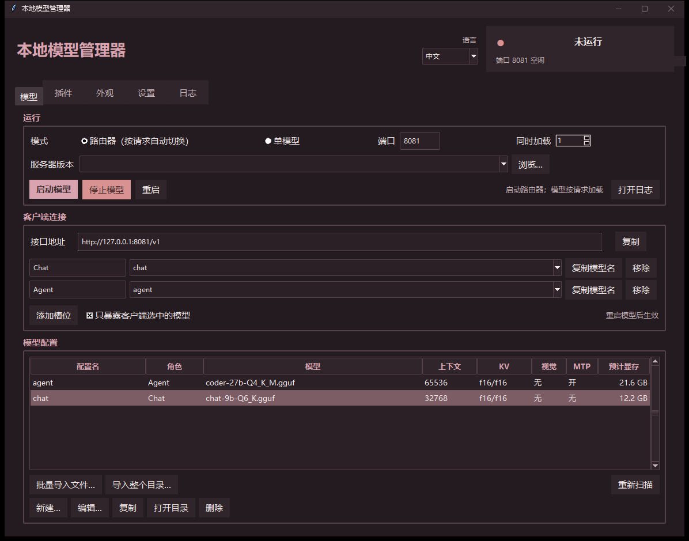

# 本地模型管理器

**Local Model Manager** · **ローカルモデルマネージャー**

一个只用 Python 标准库、不需要额外装包的 [llama.cpp](https://github.com/ggml-org/llama.cpp) 桌面管理器。

[English](README.md) · **简体中文** · [日本語](README.ja.md)

它可以把多个 GGUF 模型配置成不同的「档位」，并按请求自动切换。
同一个 llama.cpp **路由**端点，可以同时服务一个聊天客户端和一个编程 Agent，
每次只加载请求里指定的那个模型。



---

## 功能

- **批量导入**：一次导入多个 GGUF，或直接导入整个目录。
- **模型配置**：模型、视觉投影、上下文长度、KV 缓存类型、GPU 层数、批大小、
  额外参数、MTP、加载模式。
- **客户端槽位**：任意数量的命名端点，每个绑定一个模型配置。
- **路由模式**：只开一个 `llama-server`，把所有配置暴露成模型别名，按需加载。
- **单模型模式**：同一时间只跑一个模型。
- **显存估算**：从 GGUF 元数据计算模型 + KV + 视觉 + 计算缓冲 + CUDA 上下文，
  并尽量读取实时显存。
- **插件卡片**：SillyTavern、Genie TTS、GPT-SoVITS 一键启动。
- **中 / 英 / 日界面**，切换即时生效。
- **不依赖第三方 Python 包**：管理器只使用 Python 标准库，不需要 `pip install`
  （可选的 TTS 包装层除外，它有自己的 `requirements-tts.txt`）。

---

## 环境要求

- 仅支持 Windows 10/11。Linux 和 macOS **不支持**（未测试）。
- Python 3.10 及以上，带 Tkinter。
- 一份包含 `llama-server` 的 [llama.cpp](https://github.com/ggml-org/llama.cpp) 构建。
- 同时支持 CUDA 和 Vulkan 两种 llama.cpp 构建。
- 已测试：RX 6750 GRE 12G、RTX 2080 Ti 22G、RTX 4060 Ti 8G。

---

## 快速开始

1. 把 llama.cpp 构建放在任意位置。如果没有自动识别，在 **设置** 里点 **浏览…**
   手动选择 `llama-server`。CUDA 或 Vulkan 构建都可以。
2. 启动管理器：Windows 双击 `启动管理器.bat`，或运行 `python model_manager.pyw`。
3. 打开 **模型** 页，点 **批量导入**，选择你的 `.gguf` 文件。
4. 打开 **客户端** 页，为你想要调用的模型建一个槽位，并选中它。
5. 点 **启动**。

`config.json` 会自动生成在脚本旁边。所有路径都相对于这个目录，
整个文件夹可以直接搬走。

---

## 路由模式

路由模式下只有一个 `llama-server` 监听一个端口。每个模型配置变成一个别名，
请求里写哪个 `model`，就加载哪个：

```json
{"model": "chat",  "messages": [...]}
{"model": "agent", "messages": [...]}
```

同一时间只加载请求里指定的那个模型。
这样聊天前端和编程 Agent 可以共用一个端点，不用开两个服务。

完整字段说明见 [docs/configuration.md](docs/configuration.md)。

---

## 插件与服务

**插件** 页会把本地服务显示成可点击的卡片。管理器会在自身及上级目录中探测：

| 服务 | 探测路径 | 默认端口 |
|---|---|---|
| Genie TTS | `Genie-TTS GUI/server.bat` 或 `tts/server.bat` | 9880 |
| TTS Proxy | `Genie-TTS GUI/start-proxy.bat` 或 `tts/start-proxy.bat` | 9881 |
| GPT-SoVITS API | `tts/start-gsv-api.bat` | 9883 |
| GSV Proxy | `tts/start-gsv-proxy.bat` | 9882 |

端口只是默认值，可以直接在对应的 `.bat` 文件里改。

SillyTavern 也可以接入，但管理器不管它的端口，请在 SillyTavern 自己那边配置，
或者把它添加为自定义服务。

其他程序可以添加为「自定义服务」。**本仓库不打包这些软件**，
管理器只负责调用你已经装好的程序。

### 内置 TTS 辅助

`tts/` 目录里包含两个引擎的包装脚本：

- `server.py`：加载一个角色模型，启动 Genie TTS 服务（9880）
- `proxy.py`：Genie 的 OpenAI 风格 `/v1/audio/speech` 代理（9881）
- `start-gsv-api.bat`：从 `tts/GPT-SoVITS/` 启动 GPT-SoVITS（9883）
- `gsv_proxy.py`：GPT-SoVITS `api_v2` 的 OpenAI 风格代理（9882）

`server.py` / `proxy.py` 基于 [genie-tts](https://github.com/High-Logic/Genie)（MIT）。
`start-gsv-api.bat` 和 `gsv_proxy.py` 需要你自己安装 GPT-SoVITS 引擎，仓库不打包它。

**语音模型不包含在仓库里**，安装步骤见 [TTS 安装指南](tts/README.zh.md)。

---

## 安全

服务默认只绑定 `127.0.0.1`。如果要暴露到局域网，请在 **设置** 里配置 API Key。
管理器不会上传任何数据。

---

## 致谢

基础代码由 **DeepSeek**（AI 助手）编写，作者只做了调整和修改。

---

## 许可证

MIT  llama.cpp 同样是 MIT，本项目不打包它的代码。
